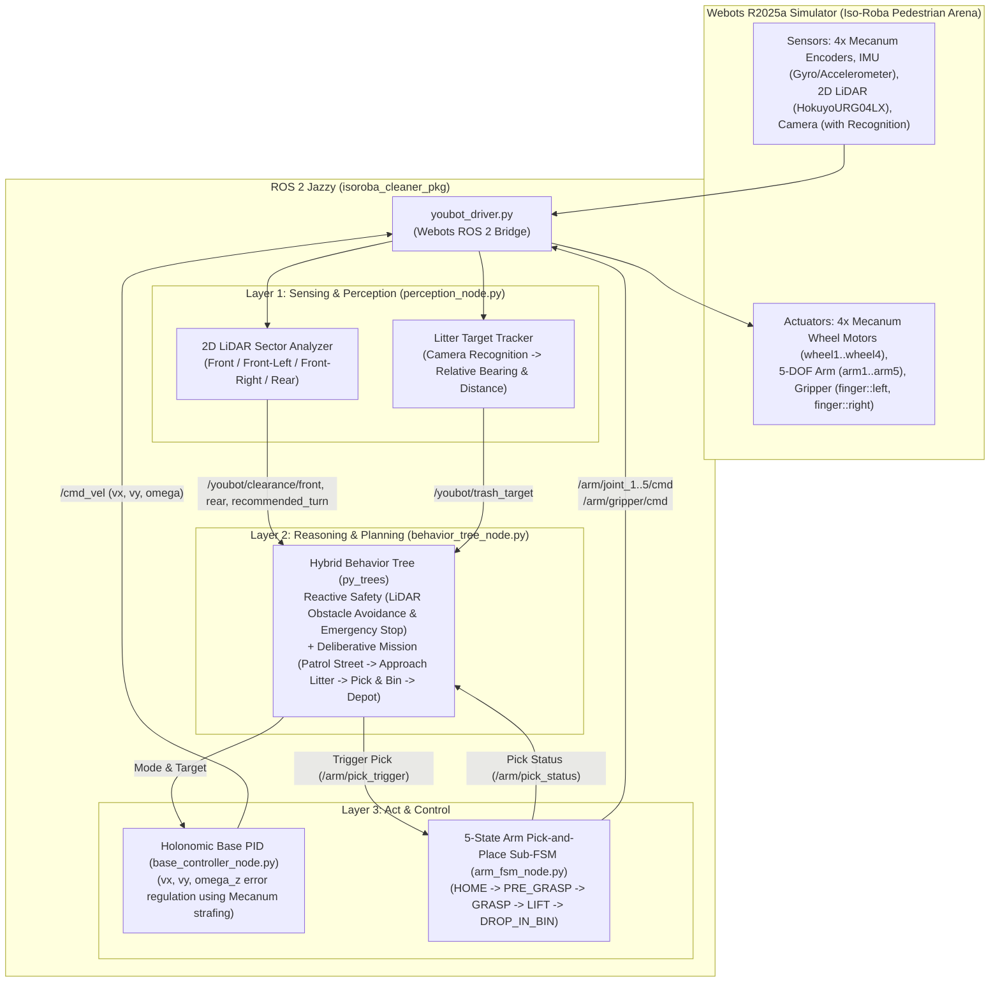

# System Architecture: Iso-Roba Pedestrian Street Clean-Up Robot

**Course**: TEKS4430 – Autonomous Cyber-Physical Systems  
**Setting**: Finnish pedestrian walking district (inspired by *Iso Roobertinkatu*, Helsinki)  
**Robot Platform**: KUKA `Youbot` (4-wheel Mecanum base + 5-DOF arm + parallel gripper)  
**Frameworks**: ROS 2 Jazzy (Docker) + Webots R2025a (Host)

---

## 1. Architectural Overview

The **Iso-Roba Clean-Up Robot** is an Autonomous Cyber-Physical System (CPS) built around a standard **KUKA `Youbot`** (`Youbot.proto`, `name "youbot"`). It operates on a flat, stone-paved pedestrian street flanked by building facades and urban obstacles (benches, cafe terraces, bike racks). It uses omnidirectional mobility to align with litter items, an onboard 5-DOF arm to grasp and deposit trash into a rear-deck bin, and a 2D LiDAR to maintain clearance from obstacles.

---

## 2. Three-Layer CPS Mapping

| CPS Layer | ROS 2 Node(s) | Responsibilities | Course Baseline Reference |
| :--- | :--- | :--- | :--- |
| **Layer 1: Sensing & Perception** | `perception_node.py` | • Splits 2D LiDAR into clearance sectors (`front`, `front_left`, `front_right`, `rear`). • Extracts litter 3D relative bearing and distance from Camera `Recognition`. | Assignments 2 & 3 |
| **Layer 2: Reasoning & Decision-Making** | `behavior_tree_node.py` | • High-priority reactive safety: obstacle avoidance around street furniture. • Deliberative mission: sweeping patrol, target lock, triggering manipulation FSM. • Abort handling and state transitions. | Assignment 3 (`py_trees`) |
| **Layer 3: Act & Control** | `base_controller_node.py` `arm_fsm_node.py` | • **Base**: Holonomic PID regulating $(v_x, v_y, \omega_z)$ to park at pick standoff distance. • **Arm**: Deterministic 5-state trajectory (`HOME` $\rightarrow$ `PRE_GRASP` $\rightarrow$ `GRASP` $\rightarrow$ `LIFT` $\rightarrow$ `DROP_IN_BIN`). | Assignment 4 (Tasks 2 & 3) |

---

## 3. Communication Topic Interfaces

| Topic Name | Message Type | Publisher Node | Subscriber Node(s) | Role |
| :--- | :--- | :--- | :--- | :--- |
| `/cmd_vel` | `geometry_msgs/msg/Twist` | `base_controller_node` | `youbot_driver` | Holonomic base velocity commands ($v_x, v_y, \omega_z$). |
| `/scan_front`, `/scan_rear` | `sensor_msgs/msg/LaserScan` | `youbot_driver` | `perception_node` | Raw 2D LiDAR distances. |
| `/camera/recognized_trash` | `geometry_msgs/msg/PoseArray` | `youbot_driver` | `perception_node` | Raw recognized object 3D poses in `camera_link` (unfiltered hardware bridge). |
| `/youbot/clearance/front`, `/youbot/clearance/rear` | `std_msgs/msg/Float32` | `perception_node` | `behavior_tree_node` | Minimum clearance distance in front and rear collision cones (inf if clear). |
| `/youbot/clearance/recommended_turn` | `std_msgs/msg/Float32` | `perception_node` | `behavior_tree_node` | Recommended avoidance turn bias (+1.0 left, -1.0 right). |
| `/youbot/trash_target` | `geometry_msgs/msg/Point` | `perception_node` | `behavior_tree_node`, `base_controller_node` | Locked litter target $(x, y)$ in robot frame. |
| `/youbot/base_mode` | `std_msgs/msg/String` | `behavior_tree_node` | `base_controller_node` | Selected base control mode (`IDLE`, `PATROL`, `APPROACH`). |
| `/arm/pick_trigger` | `std_msgs/msg/Bool` | `behavior_tree_node` | `arm_fsm_node` | Starts the pick-and-place cycle. |
| `/arm/pick_status` | `std_msgs/msg/String` | `arm_fsm_node` | `behavior_tree_node` | Feedback (`BUSY`, `SUCCESS`, `FAILED`). |
| `/arm/abort` | `std_msgs/msg/Bool` | `behavior_tree_node` | `arm_fsm_node` | Preempts pick action back to `HOME`. |
