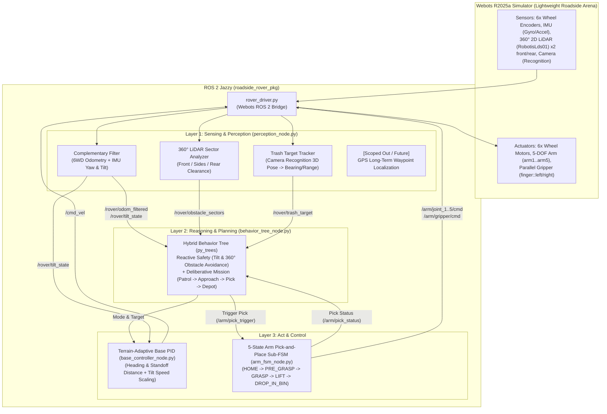
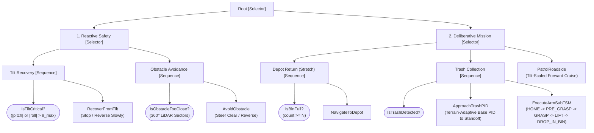
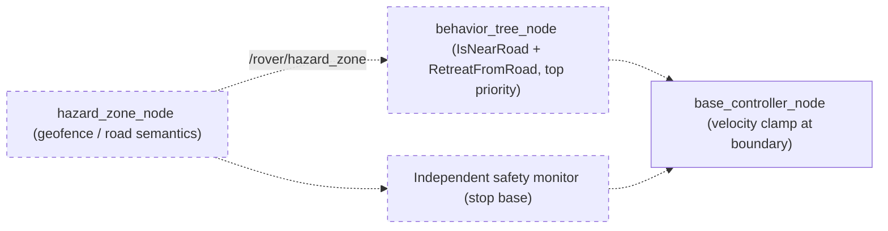

# System Architecture: Roadside Rough-Terrain Trash Collection Rover

**Course**: TEKS4430 – Autonomous Cyber-Physical Systems  
**Frameworks**: ROS 2 Jazzy (Docker) + Webots R2025a (Host)

---

## 1. Architectural Overview

The **Roadside Rough-Terrain Trash Collection Rover** is a 3-layer Autonomous Cyber-Physical System (CPS) built around a **K-Team `Koala` 6WD rover** retrofitted with a **5-DOF manipulator arm** (`Youbot` arm extraction), an **onboard rear collection bin**, a **360° 2D LiDAR**, a **Camera with `Recognition`**, and an **IMU + 6-wheel encoders**.

---

## 2. Three-Layer CPS Mapping

| CPS Layer | ROS 2 Node(s) | Responsibilities | Course Baseline Reference |
| :--- | :--- | :--- | :--- |
| **1. Sensing & Perception** | `perception_node.py` | • **Complementary Filter**: Fuses 6-wheel encoders with IMU gyro/accelerometer to correct wheel-slip yaw drift and compute roll/pitch tilt angles. • **360° LiDAR Processing**: Computes minimum safe distances across front, side, and rear sectors. • **Trash Recognition**: Extracts nearest collectible trash item distance and bearing from Webots Camera recognition objects. | Assignment 2 (Sensor Fusion & IMU/Odom Drift) |
| **2. Reasoning, Planning & Decision-Making** | `behavior_tree_node.py` | • **Reactive Layer (`py_trees`)**: Continuously checks IMU tilt thresholds (rollover prevention) and 360° LiDAR proximity (collision avoidance including reversing). • **Deliberative Layer (`py_trees`)**: Coordinates patrolling, approaching detected trash, triggering the arm Sub-FSM, and (stretch goal) returning to the depot when full. | Assignment 3 (Hybrid Reactive–Deliberative Behavior Trees) |
| **3. Act & Control** | `base_controller_node.py` (Base PID, sole `/cmd_vel` publisher) `arm_fsm_node.py` (Arm Sub-FSM) | • **Terrain-Adaptive Base PID**: Closed-loop angular & linear velocity control to park at the exact arm reach standoff ($d_{\text{pick}}$), scaling max velocity inversely with IMU tilt. • **Arm Pick-and-Place Sub-FSM**: 5-state sequence driving `arm1`–`arm5` and gripper fingers to grasp trash in front and deposit it into the rear onboard bin. | Assignment 4 (5-DOF Arm Kinematics, PID & Pick-and-Place FSM) |

---

## 3. Hybrid Behavior Tree & Sub-FSM Structure

---

> **Note**: Layer 2 planning is intentionally simple for this PoC (reactive safety + patrol/approach/pick). A real system would add higher-level mission planning (coverage/route planning, task allocation, map-based depot navigation).

## 4. ROS 2 Topic Interface Summary

| Topic | Message Type | Publisher | Subscriber | Description |
| :--- | :--- | :--- | :--- | :--- |
| `/scan_front`, `/scan_rear` | `sensor_msgs/LaserScan` | `rover_driver` | `perception_node` | 360° 2D LiDAR scans (front and rear units, self-occluded sectors masked) |
| `/imu/data_raw` | `sensor_msgs/Imu` | `rover_driver` | `perception_node` | Raw IMU gyroscope & accelerometer data |
| `/wheel_odom_raw` | `nav_msgs/Odometry` | `rover_driver` | `perception_node` | Raw 6-wheel encoder odometry |
| `/camera/recognized_trash` | `geometry_msgs/PointStamped` | `rover_driver` | `perception_node` | Closest trash position in robot frame (`x, y, z`) |
| `/rover/odom_filtered` | `nav_msgs/Odometry` | `perception_node` | `behavior_tree_node` | Slip-compensated Complementary Filter pose |
| `/rover/tilt_state` | `geometry_msgs/Vector3` | `perception_node` | `behavior_tree_node` | `x`: roll (rad), `y`: pitch (rad), `z`: tilt speed scale $[0.2, 1.0]$ |
| `/rover/trash_target` | `geometry_msgs/Point` | `perception_node` | `behavior_tree_node` | `x`: distance (m), `y`: bearing (rad), `z`: valid flag ($1.0$ or $0.0$) |
| `/rover/obstacle_sectors` | `std_msgs/Float32MultiArray` | `perception_node` | `behavior_tree_node`, `base_controller_node` | Min clearance (m): front, front-left, front-right, rear |
| `/rover/base_mode` | `std_msgs/String` | `behavior_tree_node` | `base_controller_node` | Base mode selected by the BT (`PATROL`, `APPROACH`, `AVOID`, `RECOVER`, `STOP`) |
| `/cmd_vel` | `geometry_msgs/Twist` | `base_controller_node` | `rover_driver` | Differential-drive linear/angular velocity command |
| `/arm/joint_1..5/cmd` | `std_msgs/Float64` | `arm_fsm_node` | `rover_driver` | Target joint angles for the 5-DOF arm |
| `/arm/gripper/cmd` | `std_msgs/Float64` | `arm_fsm_node` | `rover_driver` | Gripper finger opening width ($0.0\text{ m}$ to $0.0245\text{ m}$) |
| `/arm/pick_trigger` | `std_msgs/Bool` | `behavior_tree_node` | `arm_fsm_node` | Triggers the 5-state pick-and-place cycle |
| `/arm/abort` | `std_msgs/Bool` | `behavior_tree_node` | `arm_fsm_node` | Abort current pick and stow arm to `HOME` (sent when the BT preempts `ExecuteArmSubFSM`) |
| `/arm/pick_status` | `std_msgs/String` | `arm_fsm_node` | `behavior_tree_node` | Current FSM state (`IDLE`, `BUSY`, `SUCCESS`, `FAILED`, `ABORTED`) |

---

## 5. Architecture Decision Records (ADRs)

All key architectural choices are documented in `docs/adr/`:
- [ADR-001: Robot Platform & Manipulation Hardware](adr/001-robot-platform-and-arm.md)
- [ADR-002: Lightweight Simulation Environment Design](adr/002-lightweight-simulation-world.md)
- [ADR-003: Sensing, Perception & State Estimation Pipeline](adr/003-sensing-and-perception.md)
- [ADR-004: Hybrid Behavior Tree & Arm Sub-FSM Architecture](adr/004-hybrid-reasoning-architecture.md)
- [ADR-005: Terrain-Adaptive Control & Grasping Reliability](adr/005-actuation-and-control.md)
- [ADR-006: ROS 2 Package & Node Topology](adr/006-ros2-package-topology.md)
- [ADR-007: Road/Hazard-Zone Exclusion Not Implemented (Known Safety Gap)](adr/007-road-exclusion-not-implemented.md)

---

## 6. Known Limitations & Future Safety Architecture

- **No road/hazard-zone exclusion (critical safety gap).** The rover has no semantics to distinguish the road from the verge, so nothing stops it from driving onto the carriageway. The PoC's world walls are a test-bench boundary only. Decision and future design: [ADR-007](adr/007-road-exclusion-not-implemented.md).
- **Future layer placement (not implemented):**

- **Simulation fidelity:** the road is visual-only, and the terrain is a coarse `ElevationGrid` ([ADR-002](adr/002-lightweight-simulation-world.md)).

---

## Sources
- [TEKS4430 Course Project Specification](../ASSIGNMENT.md) (`https://github.com/TEKS4430/Autumn-2026_project`)
- [Webots R2025a Koala Documentation](https://cyberbotics.com/doc/guide/koala)
- [Webots R2025a KUKA YouBot Documentation](https://cyberbotics.com/doc/guide/youbot)
- [py_trees Official Documentation](https://py-trees.readthedocs.io/en/devel/)
