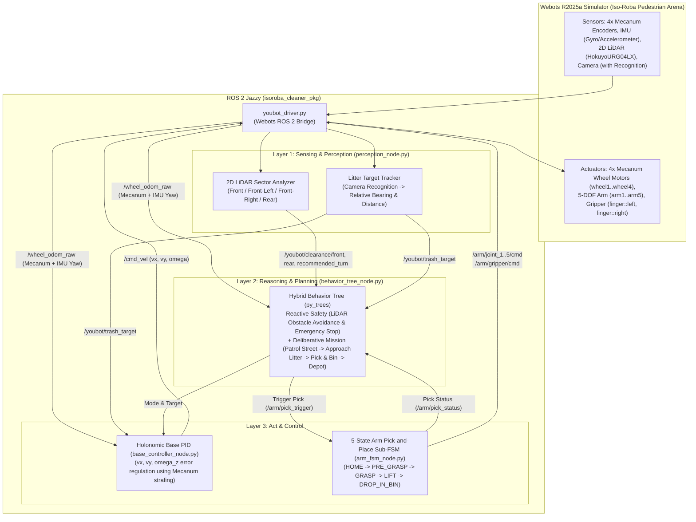

# System Architecture: Iso-Roba Pedestrian Street Clean-Up Robot

**Course**: TEKS4430 – Autonomous Cyber-Physical Systems  
**Setting**: Finnish pedestrian walking district (inspired by *Iso Roobertinkatu*, Helsinki)  
**Robot Platform**: KUKA `Youbot` (4-wheel Mecanum base + 5-DOF arm + parallel gripper)  
**Frameworks**: ROS 2 Jazzy (Docker) + Webots R2025a (Host)

---

## 1. Architectural Overview

The **Iso-Roba Clean-Up Robot** is an Autonomous Cyber-Physical System (CPS) built around a standard **KUKA `Youbot`** (`Youbot.proto`, `name "youbot"`). It operates on a flat, stone-paved pedestrian street flanked by building facades and urban obstacles (benches, cafe terrace fences, public bins, static pedestrians). It uses omnidirectional mobility and IMU-fused wheel odometry to align with litter items, an onboard 5-DOF arm to grasp and deposit trash into a rear-deck bin, and dual 2D LiDARs (`lidar_front`, `lidar_rear`) to maintain clearance from obstacles.

---

## 2. Three-Layer CPS Mapping

| CPS Layer | ROS 2 Node(s) | Responsibilities | Course Baseline Reference |
| :--- | :--- | :--- | :--- |
| **Layer 1: Sensing & Perception** | `perception_node.py` | • Evaluates dual 2D LiDAR front/rear collision cones (`[-30°, +30°]`) and left/right hemisphere steering bias (`[0°, +90°]` vs. `[-90°, 0°]`). • Filters Camera `Recognition` detections by model name (`biscuit box`), ground height, and reach window in `base_link`. | Assignments 2 & 3 |
| **Layer 2: Reasoning & Decision-Making** | `behavior_tree_node.py` | • High-priority reactive safety: two-stage obstacle avoidance around street furniture with arm self-occlusion deadband. • Deliberative mission: IMU-stabilized corridor patrol, target lock, and two-phase manipulation FSM handshake. • Preemptive `/arm/abort` handling and post-failure retry cooldown. | Assignment 3 (`py_trees`) |
| **Layer 3: Act & Control** | `base_controller_node.py` `arm_fsm_node.py` | • **Base**: Holonomic PID regulating $(v_x, v_y, \omega_z)$ to park at the `0.45 m` pick standoff distance aligned with the corridor. • **Arm**: Deterministic 8-state FSM (`IDLE`, `PRE_GRASP`, `GRASP`, `CLOSE_GRIPPER`, `LIFT`, `DROP_IN_BIN`, `RELEASE_GRIPPER`, `RETURN_HOME`) executing the 5-stage pick-and-place trajectory. | Assignment 4 (Tasks 2 & 3) |

---

## 3. Communication Topic Interfaces

| Topic Name | Message Type | Publisher Node | Subscriber Node(s) | Role |
| :--- | :--- | :--- | :--- | :--- |
| `/cmd_vel` | `geometry_msgs/msg/Twist` | `base_controller_node` | `youbot_driver` | Holonomic base velocity commands ($v_x, v_y, \omega_z$). |
| `/wheel_odom_raw` | `nav_msgs/msg/Odometry` | `youbot_driver` | `behavior_tree_node`, `base_controller_node` | Mecanum wheel odometry fused with `InertialUnit` (IMU) yaw for corridor heading/centerline patrol and box-aligned holonomic approach. |
| `/scan_front`, `/scan_rear` | `sensor_msgs/msg/LaserScan` | `youbot_driver` | `perception_node` | Raw front and rear 2D LiDAR distance scans. |
| `/imu/data_raw` | `sensor_msgs/msg/Imu` | `webots_ros2_driver::Ros2IMU` | *(Telemetry / RViz)* | Raw 6-DOF IMU telemetry (`inertial_unit`, `gyro`, `accelerometer`). |
| `/camera/recognized_trash` | `geometry_msgs/msg/PoseArray` | `youbot_driver` | `perception_node` | Raw recognized object 3D poses in `camera_link` (unfiltered hardware bridge). |
| `/camera/recognized_trash_models` | `std_msgs/msg/String` | `youbot_driver` | `perception_node` | Comma-separated Webots `Recognition` model names corresponding to `/camera/recognized_trash` for PoC semantic filtering. |
| `/joint_states` | `sensor_msgs/msg/JointState` | `youbot_driver` | `arm_fsm_node` | Measured positions of `arm1`–`arm5` and `finger::left`/`finger::right` for closed-loop waypoint and grasp verification. |
| `/youbot/clearance/front`, `/youbot/clearance/rear` | `std_msgs/msg/Float32` | `perception_node` | `behavior_tree_node` | Minimum clearance distance in front and rear `[-30°, +30°]` collision cones (`inf` if clear). |
| `/youbot/clearance/recommended_turn` | `std_msgs/msg/Float32` | `perception_node` | `behavior_tree_node` | Recommended avoidance turn/strafe bias (`+1.0` left, `-1.0` right). |
| `/youbot/trash_target` | `geometry_msgs/msg/Point` | `perception_node` | `behavior_tree_node`, `base_controller_node`, `arm_fsm_node` | Closest valid litter target $(x, y, z)$ in `base_link` frame. |
| `/youbot/base_mode` | `std_msgs/msg/String` | `behavior_tree_node` | `base_controller_node` | Selected base control mode (`IDLE`, `PATROL`, `APPROACH`, `AVOID`). |
| `/youbot/bt_cmd_vel` | `geometry_msgs/msg/Twist` | `behavior_tree_node` | `base_controller_node` | Base velocity command forwarded by `base_controller_node` in `PATROL`/`AVOID` modes. |
| `/youbot/base_parked` | `std_msgs/msg/Bool` | `base_controller_node` | `behavior_tree_node` | `True` once `APPROACH` PID holds within pick standoff tolerance for 5 consecutive cycles. |
| `/arm/pick_trigger` | `std_msgs/msg/Bool` | `behavior_tree_node` | `arm_fsm_node` | Starts the pick-and-place cycle. |
| `/arm/pick_status` | `std_msgs/msg/String` | `arm_fsm_node` | `behavior_tree_node` | Manipulation status feedback (`IDLE`, `BUSY`, `SUCCESS`, `FAILED`). |
| `/arm/abort` | `std_msgs/msg/Bool` | `behavior_tree_node` | `arm_fsm_node` | Preempts active pick action and stows arm back to `HOME`. |
| `/arm/joint_1..5/cmd` | `std_msgs/msg/Float64` | `arm_fsm_node` | `youbot_driver` | Target joint angles (rad) for `arm1` through `arm5`. |
| `/arm/gripper/cmd` | `std_msgs/msg/Float64` | `arm_fsm_node` | `youbot_driver` | Target parallel finger opening (`0.0` closed to `0.025 m` open per finger). |
